# DataGuard AI

**A reproducible data quality portfolio project built with Python, PostgreSQL and
Streamlit, with optional AI-assisted interpretation.**

**Author: Philipp Kulbatskiy**

Data quality errors can distort joins, financial aggregates and fulfillment
analysis. DataGuard AI preserves source text, detects explicit rule violations,
tests the detector against controlled corruptions, and presents traceable evidence
and investigation guidance. It does not repair data automatically.

This portfolio project emphasizes explainable engineering and honest measurement.
It is not presented as production-ready or as universal data-quality coverage.
The repository includes an Olist reference pipeline and a generic CSV analyzer.

## Measured results

| Stage | Observed result | What it means |
| --- | --- | --- |
| Ingestion | **1,550,922 rows across nine tables** | CSV, COPY and database row counts reconciled; rows are not unique orders |
| Original validation | **189 chronology violations and eight warnings** | Eight declared deterministic rules; warnings are distinct from confirmed violations |
| Controlled pilot | **1,000 selected orders, 70 mutation events** | Seven predefined mutation types, ten events each, in an isolated experiment schema |
| Detection benchmark | **80 TP, 0 FP, 0 FN; precision/recall/F1 = 100%** | Finding-level results on the predefined synthetic benchmark only |
| Explanation grouping | **197 findings → three evidence groups** | Aggregate structural evidence without raw source values or business IDs |
| Historical live AI test | **Three requests; USD 0.004783 estimated** | 2,359 input / 606 output tokens; validated selections matched offline output; no additional analytical benefit demonstrated |

**The 100% scores do not measure general real-world accuracy.** The mutation
scenarios were designed around known rule contracts, there is no independent
real-world labeled holdout, and plausible wrong values can evade the rules. DQ008
has no positive mutation case in this benchmark; its undefined per-rule scores
remain N/A. One duplicate mutation produces two expected findings, explaining
why 70 events correspond to 80 finding obligations. See
[benchmark interpretation](docs/EVALUATION.md#publication-interpretation).

Counts and validation snapshots were recorded on 2026-10-19. Offline/live
explanation snapshots are dated 2026-10-23. Phase 5B verification is dated
2026-10-24. The dashboard displays report timestamps and never implies a fresh
scan of the database. AI cost is a conservative estimate using recorded rate
assumptions, not an invoice.

## Try the CSV analyzer without credentials or API calls

Requirements: Python **3.11+** and [uv](https://docs.astral.sh/uv/).
Run from the repository root:

```sh
uv sync --locked
uv run streamlit run src/dataguard_ai/dashboard/app.py
```

Open [the local dashboard](http://127.0.0.1:8501) and select
**Mode → Analyze Your CSV**. Follow the [synthetic CSV walkthrough](docs/DEMO.md).
Dependencies require a package-index connection on first installation; analysis
itself makes no API/database requests. No OpenAI API key is required.

Olist-derived report JSONs and screenshots are **not distributed** in this release:
their suitability for this portfolio's intended use remains unresolved under the
noncommercial dataset terms. See [the individual asset review](docs/DATASET_LICENSE.md).
The Olist mode remains implemented; without locally generated reports it displays
unavailable sections honestly. It never invents replacement metrics. To inspect
your own reports, set `DATAGUARD_REPORT_DIR` to their local directory. Original
raw files, local projections and historical live-test outputs remain excluded.

## Analyze your own CSV

Choose **Mode → Analyze Your CSV** in the same dashboard. Upload an authorized CSV,
select its encoding/delimiter, choose required, unique, numeric, nonnegative and
formatted date/time columns, then click **Analyze CSV**. With no constraints,
analysis produces a structural profile only. Arbitrary column names are supported;
no Olist schema is assumed. No additional dependency, database or API key is needed.

The profile shows rows, columns, inferred types, missing cells, duplicate rows and
candidate unique columns. Findings contain rule IDs, data-row numbers and column
names; JSON download omits filenames and cell values. An explicit checkbox reveals
a local preview of the first 20 records. Uploaded bytes reach the Streamlit server:
a remote host would receive them. This local analyzer does not persist uploads or
send them to PostgreSQL or external AI APIs. Review even value-free reports before
sharing, since column names and counts can be sensitive.

Limits: **5 MiB, 50,000 rows, 100 columns, 250,000 cells, 64 MiB estimated working
memory**, 16,000 characters per cell and 1,000 detailed findings with complete
failure totals. Exceeding an input limit rejects the analysis. Memory estimation
is not a hard process-memory guarantee or protection for concurrent public hosting.
The generic checks cannot detect all semantic or business errors and have no
claimed benchmark accuracy. Existing Olist metrics apply only to the original demo.
See [usage, architecture and boundaries](docs/GENERIC_CSV.md).


## Architecture

```mermaid
flowchart LR
    UP["User CSV: session memory"] --> GEN["Bounded generic profile + configured checks"]
    GEN --> GUI["Upload dashboard + value-free JSON download"]
    CSV["Private Olist CSVs"] --> ING["Transactional COPY ingestion"]
    ING --> RAW["PostgreSQL raw: original text"]
    RAW --> DQ["Eight deterministic checks: read only"]
    RAW --> PILOT["Isolated experiment copy"]
    PILOT --> MUT["Seeded corruption + mutation manifest"]
    MUT --> PDQ["Same deterministic checks"]
    PDQ --> EVAL["One-to-one benchmark evaluation"]
    DQ --> REPORTS["Private evidence reports"]
    EVAL --> REPORTS
    REPORTS --> GROUP["Allowlisted aggregate evidence"]
    GROUP --> OFF["Offline reviewed catalog: default"]
    GROUP -. "explicit opt-in only" .-> AI["OpenAI structured selection"]
    OFF --> EXPL["Validated explanation reports"]
    AI --> EXPL
    REPORTS --> PROJ["Privacy projection + provenance checks"]
    EXPL --> PROJ
    PROJ --> UI["Read-only Streamlit dashboard"]
```



**Detection is deterministic; AI-assisted interpretation is constrained.** SQL
and Python rules decide what is a finding, with explicit severity and evidence.
The model receives aggregate counts, allowlisted structural fields and reviewed
options; it selects hypothesis/impact/investigation IDs. Python owns counts,
summary templates and confidence limits. Local validation rejects unknown claims
and changed facts. A schema-valid hypothesis is still unconfirmed.

The offline provider is the default. Live calls require an explicit paid-request
flag, request/token/cost limits and separately approved use. SDK retries are
turned off; offline fallback requires an explicit flag. The dashboard has no
control that invokes either a paid request or a database write.
[Architecture decisions](docs/ARCHITECTURE.md) · [OpenAI provider](docs/OPENAI_PROVIDER.md).

## Technologies and code map

| Component | Technology / responsibility |
| --- | --- |
| Profiling | Pandas; CSV relationships and missingness |
| Ingestion | Psycopg 3, PostgreSQL 17, streaming COPY, all-table transaction |
| Quality | Eight Python/SQL rules with explicit evidence contracts |
| Experiments | Seeded bounded mutation plans in an owned isolated schema |
| Evaluation | Baseline-aware one-to-one obligation matching |
| Explanations | Provider protocol, reviewed catalog, official OpenAI Python SDK |
| Dashboard | Streamlit; validated field projection and pure filtering |
| Reproducibility | `pyproject.toml`, `uv.lock`, Docker Compose, pytest, Ruff |

```text
src/dataguard_ai/
  ingestion/    CSV profiling, raw schema, transactional loading
  quality/      Rule contracts and read-only validation engine
  corruption/   Seeded plans, isolated writes and mutation provenance
  evaluation/   Matching policy, metrics and read-only evaluation
  ai/           Grouping, reviewed catalog, offline/OpenAI providers
  dashboard/    Safe report parsers, publication export and Streamlit views
  generic/      Independent bounded CSV parsing, profiling and configured checks
tests/          Synthetic unit tests and opt-in disposable DB integration tests
reports/portfolio/  Explanation of withheld local projections; no report JSONs shipped
scripts/        Mock AI demo, safe report export, publication audit
```

## Reproduce the checks

```sh
uv run pytest
uv run ruff check .
uv run ruff format --check .
uv run python scripts/audit_publication.py
```

Normal tests use synthetic fixtures. An additional local-only Olist snapshot check
runs when its excluded report files are present; otherwise it is explicitly skipped.
The synthetic tests require
neither private CSVs, a database, an API key nor paid requests. See the
[verification record](docs/VERIFICATION.md) for current verification
results and the [Phase 5B audit](docs/PHASE5B_AUDIT.md) for historical results.
The final staged-only test results are recorded in the verification record. Generic retail, sensor and classroom schemas exercise the
upload analyzer; all four Olist views and public projection contracts are tested.
Database integration tests are opt-in and require a **separate, empty, disposable
`_test` database**. A session preflight rejects the configured source database and
existing user schemas/objects before fixture writes. No database is created or
reset implicitly. See [database setup and safe tests](docs/DATABASE.md).

## Reproduce the full pipeline separately

Obtain the [Brazilian E-Commerce Public Dataset by Olist](https://www.kaggle.com/datasets/olistbr/brazilian-ecommerce)
under **CC BY-NC-SA 4.0** and place the nine CSV files in ignored `data/raw/`.
Follow the [download and licensing instructions](docs/DATASET_LICENSE.md); raw
files and archives are excluded, and the MIT code proposal does not relicense them.
Configure local credentials from `.env.example`; never commit `.env`.

1. Profile local CSVs: `uv run dataguard-ai profile`.
2. Follow [database setup](docs/DATABASE.md). Ingestion replaces all nine raw tables
   transactionally; run it only against your intended local dataset, with approval
   if existing contents could be lost.
3. Run [read-only validation](docs/QUALITY.md).
4. Create the [bounded corruption pilot](docs/EXPERIMENTS.md) only in a disposable
   owned experiment schema, then run [evaluation](docs/EVALUATION.md).
5. Generate [offline explanations](docs/EXPLANATIONS.md). No live API call is needed
   for a complete dashboard demonstration.

Private runs write to ignored `reports/generated/`. To create a new reviewed
public projection after all six source reports exist:

```sh
uv run python scripts/export_portfolio_reports.py --output-dir reports/portfolio-review
```

The exporter refuses an existing destination and never overwrites private inputs.
Review the result and rerun the publication audit before considering it for Git.
Do not stage a new export merely because it was generated successfully.

## Limits and publication boundaries

- Rules catch declared structural/domain conditions, not every incorrect fact.
  Plausible price changes, swapped valid references and consistent date shifts may
  evade detection. Source timestamps and lifecycle semantics need human context.
- Findings, distinct affected rows and mutation events are different units. Group
  row counts can overlap; do not sum them into unique affected orders.
- Reviewed hypotheses are possibilities, not confirmed causes or probabilities.
  No financial loss is measured; the catalog has limited expressive coverage.
- The Olist dashboard mode shows saved reports, not live monitoring. Report consistency and
  source hashes do not prove authenticity or that the detector is complete.
- The original CSVs and record-level reports are excluded from Git. The local
  projections and Olist screenshots are also excluded pending intended-use clearance.
- This is a local portfolio application with no authentication, deployment,
  production monitoring, automated repair or account-wide API spending guarantee.
- Original project code is available under the [MIT License](LICENSE).
  [NOTICE.md](NOTICE.md) separately attributes Olist-derived artifacts under
  CC BY-NC-SA 4.0. Review intended-use suitability before distributing those artifacts.

[Demo walkthrough](docs/DEMO.md) · [Dashboard internals](docs/DASHBOARD.md) ·
[Engineering development log](docs/LEARNING_LOG.md) ·
[Verification record](docs/VERIFICATION.md)


## Development transparency

OpenAI Codex assisted with implementation, documentation and verification.
The optional OpenAI explanation provider is a separate runtime feature described
in [the provider documentation](docs/OPENAI_PROVIDER.md). Recorded test results
and benchmark limitations are preserved in the verification record.
