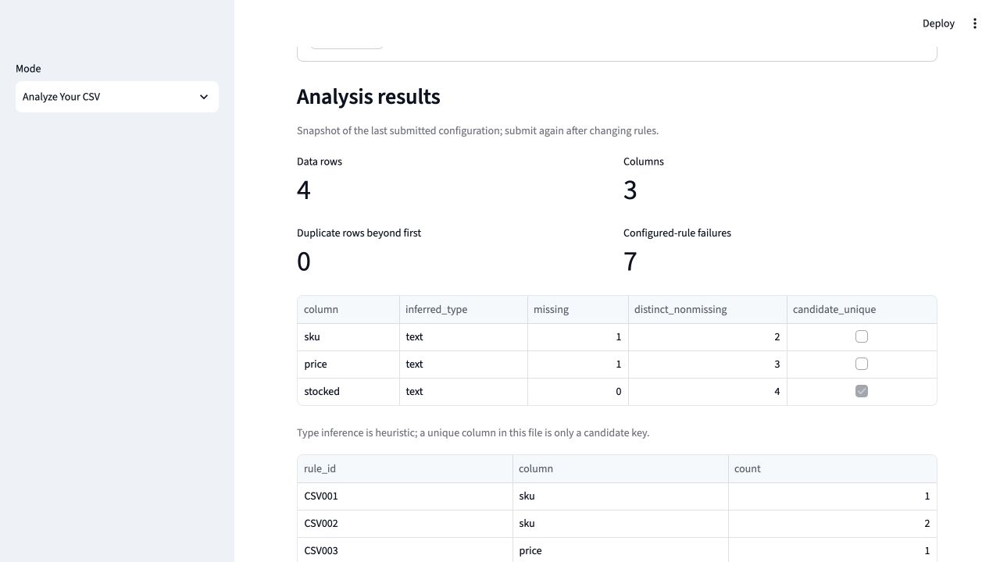

# Two-minute synthetic CSV demo

Run from the repository root, without a database or API key:

```sh
uv sync --locked
uv run streamlit run src/dataguard_ai/dashboard/app.py
```

Select **Mode → Analyze Your CSV**. The default Olist mode requires local reports;
these are excluded from the public release. Missing sections remain unavailable.
The original application/rules are preserved; no synthetic data is presented as
measured Olist results.

Create a temporary CSV outside the repository with only this synthetic input:

```csv
sku,price,stocked
A,12.5,2026-01-01
A,-2,2026-02-30
B,bad,broken
, ,2026-01-04
```

1. Upload it with UTF-8 / Comma.
2. Choose Required `sku`, Unique `sku`, Nonnegative `price`, and Date/time `stocked`
   with `%Y-%m-%d`. Click **Analyze CSV**.
3. Expect **four rows, three columns, zero duplicate whole rows and seven failures**:
   one missing required value, two repeated-key members, one invalid decimal,
   one negative number and two malformed dates. Missing price is optional here;
   adding it to Required adds one failure.
4. Enable the original-value preview deliberately. Explain that uploads reach
   the Streamlit server and are not sent to PostgreSQL or AI services.
5. Download JSON and show the value-free findings, submitted constraints and limits.
   Even headers and row positions can be sensitive in real uploads.



## Optional local Olist walkthrough

Obtain the dataset under its terms and follow [the pipeline setup](../README.md#reproduce-the-full-pipeline-separately).
Point `DATAGUARD_REPORT_DIR` at your locally generated reports. The four existing
views cover counts, findings/filtering, corruption/evaluation and AI explanations.
Offline explanation needs no API key; missing live reports remain unavailable.
Olist-derived historical screenshots and projected reports are not distributed;
see [the asset review](DATASET_LICENSE.md).

## Points to explain

- Structural observations differ from user-declared business constraints.
- Text preservation avoids losing invalid values and leading zeros.
- Decimal and explicit date formats avoid silent coercion/locale guesses.
- Resource limits reject oversized inputs; finding sampling does not truncate totals.
- Olist's historical 100% synthetic benchmark does not measure generic CSV accuracy.
- Historical live model selections matched offline; no additional analytical
  benefit was demonstrated. Hypotheses are unconfirmed and losses unmeasured.
