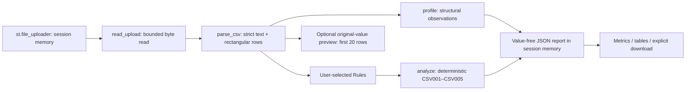

# Phase 6A — Generic CSV analysis

## Use

Start the normal Streamlit dashboard and select **Mode → Analyze Your CSV**.
This mode does not require Olist reports, PostgreSQL or an API key. Choose a CSV,
its encoding and delimiter, then select constraints and click **Analyze CSV**.
Selecting no constraints produces a profile only. The optional preview shows the
first 20 original records. Download JSON explicitly when you want to retain a report.
The Olist portfolio remains the default mode with its four existing report views.

Supported encodings are strict UTF-8 (optional BOM), UTF-16 (requires BOM) and
explicit Windows-1252. There is no lossy decoding or silent encoding fallback.
Comma, semicolon, tab and pipe delimiters are explicit. Excel workbooks, compressed
archives, binary/control-character input, duplicate/blank headers, uneven rows and
malformed quoting are rejected. Quoted delimiters and multiline cells are supported.
Names can be Unicode and need not match any Olist convention. Names are preserved
exactly, limited to 256 characters. The file must have a header; header-only files
produce a zero-row profile. Wrong delimiter choices can still yield a valid
one-column file: inspect the profile and preview before trusting the configuration.

## Architecture and important functions

`generic/analysis.py` is independent of Olist ingestion, SQL quality rules,
experiments, evaluation and AI providers. It uses the Python standard library;
there are no new dependencies. `Dataset` retains text cells without coercion or
correction, and `Rules` contains explicit configuration. `parse_csv()` rejects
oversized input rather than truncating it. `profile()` computes exact structural
observations over the accepted file. `decimal_value()` uses a syntax check and
finite `Decimal`, avoiding binary floating-point conversion. `analyze()` checks
all records and emits bounded details plus complete per-rule/per-column totals.

`dashboard/upload.py` handles presentation. `st.file_uploader` holds uploaded bytes
in Streamlit memory. `st.selectbox` chooses encoding/delimiter; `st.multiselect`
chooses arbitrary columns. `st.form` batches rule edits until `st.form_submit_button`
is pressed. `st.session_state` retains only the last report and source fingerprint
in application code, while Streamlit manages uploader/widget state. A new file or
parsing option invalidates old results and selected constraints. The same bytes
with the same parsing options are treated as the same dataset, independent of name.
`st.checkbox` gates raw preview, `st.dataframe` renders tables, and
`st.download_button` serves JSON from memory. There is no `st.cache_data`, dataset
write, SQL connection, AI request or integration with the Olist report exporter.

Results represent the **last submitted configuration**; editing widgets requires
submitting again. The report includes that configuration, UTC generation time,
parser settings, profile, limits, total failures, grouped counts and sampled
row-level findings. Data row numbers start at one and count CSV records, not
physical lines, which can differ for multiline fields. Filenames and cell values
are excluded. Arbitrary column names and row positions can still be sensitive.

## Check semantics

| Rule | Configuration | Meaning |
| --- | --- | --- |
| CSV001 | Required | Reject empty or whitespace-only cells |
| CSV002 | Unique | Flag every member of a repeated nonmissing value |
| CSV003 | Numeric, or implied by Nonnegative | Require finite dot-decimal syntax; scientific notation allowed |
| CSV004 | Nonnegative | Reject valid numbers below zero; negative zero is accepted |
| CSV005 | Date/time | Parse using the explicitly supplied Python `strptime` format |

Checks trim outer whitespace without modifying stored cells. Literal `NA`, `null`
and `None` are ordinary text. Optional checks skip missing cells; combine them
with Required when necessary. Invalid numbers generate CSV003, not an additional
CSV004. Thousands separators, decimal commas, underscores, NaN and infinity are
rejected. Date formats follow Python parsing, which accepts some unpadded components;
this is calendar/format parsing, not a byte-exact regular expression, timezone
policy, chronological business check or locale-independent natural-language parser.
The UI uses one shared format for selected date/time columns; the pure engine
accepts a per-column mapping. Separate runs can use different formats.

The profile includes exact row/column counts, per-column missing/distinct counts,
heuristic types, and complete nonmissing single-column unique candidates. Candidate
keys describe this file only, not future data or composite/business keys. Types are
suggestions (decimal-like, ISO date/time-like, text, empty), not inferred constraints.
Duplicate-row profiling compares original whole rows and counts copies beyond the
first; unique-column validation trims outer whitespace and flags all repeated members.
Neither duplicate observation automatically creates a business-rule failure.

## Resource and privacy boundaries

Defaults: **5 MiB bytes, 50,000 rows, 100 columns, 250,000 cells, 64 MiB estimated
working memory, 16,000 characters per cell, 1,000 detailed findings**. Any input
limit rejects the entire analysis. Findings alone are sampled: all failure totals
remain exact and truncation is disclosed. The server's upload cap is also 5 MB.
Memory estimation includes decoded text and conservative per-cell/object headroom;
it is not a hard RSS limit, streaming engine or guarantee under concurrent sessions.
The CSV must fit in memory; Python, Streamlit, pandas previews and browser rendering
add overhead. Larger-scale work requires separate architecture and resource isolation.

Default server binding is loopback and usage telemetry is disabled. Uploaded bytes
travel from the browser to the Streamlit server, which would receive them if this
app were hosted remotely. Only upload authorized data. Raw preview intentionally
exposes the first 20 records to that browser session; keep it off for sensitive data.
The analyzer does not persist datasets or transmit them to PostgreSQL/external APIs.
Streamlit holds upload/widget/report state while the session is alive; closing it
allows cleanup, not guaranteed immediate secure erasure. Browser memory, downloads,
OS swap, administrator access and server infrastructure are outside this guarantee.
This is a local portfolio tool, not an authenticated multi-tenant upload service.

JSON is opt-in download and still needs review before sharing. Upload reports never
enter `reports/portfolio`, the Olist parser or publication projection. Existing Git
ignores for CSVs, private reports, credentials and raw datasets remain intact. Do
not capture real uploaded data in screenshots or publication assets.

Generic checks do not detect every semantic/business error. There is no generic
accuracy score, cross-table relationship inference, automatic correction, database
write or AI interpretation in this mode. The Olist synthetic benchmark metrics
apply only to that existing demonstration, never to arbitrary uploaded CSVs.

## Verification

Synthetic retail, sensor and classroom schemas exercise missing values, duplicates,
invalid numbers, negative values and malformed dates. Additional tests cover
encodings, quoted multiline fields, safe errors, bounds, complete counts with sampled
findings, session invalidation and explicit preview. UI tests prohibit database/API
connections and operate with an absent Olist report directory. Existing Olist tests
continue to cover all four views and publication protections.
